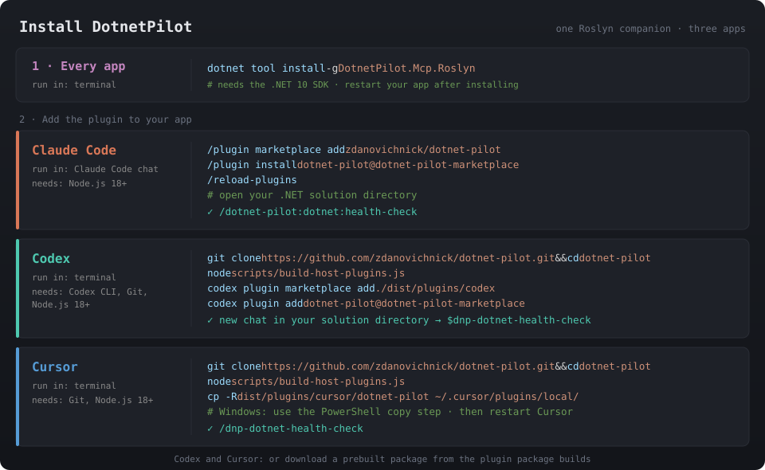
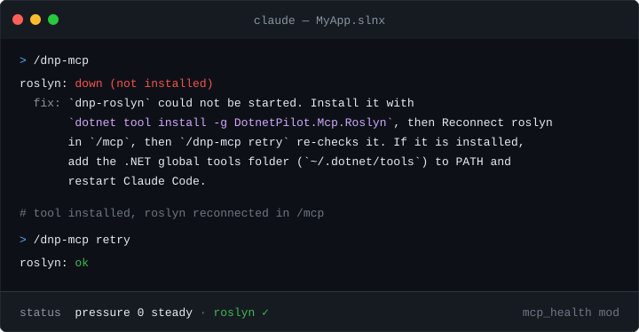
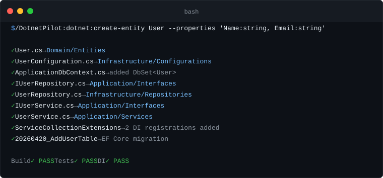
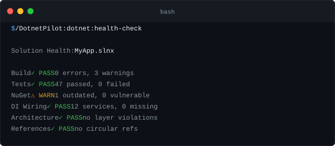

# DotnetPilot

**.NET workflows for Claude Code, Codex, and Cursor.**

Build features that follow your solution's conventions. Check dependency injection,
review architecture boundaries, and generate EF Core migrations with Roslyn-backed analysis.

[](LICENSE)
[](https://dotnet.microsoft.com/download)
[](https://www.nuget.org/packages/DotnetPilot.Mcp.Roslyn)
[](https://github.com/zdanovichnick/dotnet-pilot/actions/workflows/hooks.yml)
[](https://github.com/zdanovichnick/dotnet-pilot/actions/workflows/roslyn.yml)
[](https://github.com/zdanovichnick/dotnet-pilot/actions/workflows/host-plugins.yml)

[Install](#install) · [First steps](#first-steps) · [Compatibility](#compatibility) · [Workflows](#workflows) · [Troubleshooting](#troubleshooting)

> **New in 3.9.0** (with `dnp-roslyn` 0.5.3)
> - **Roslyn health check:** Claude Code shows `roslyn ✓` or `roslyn ✗ <reason>` in the status line
>   and explains how to fix a failed start; run `/dnp-mcp` for details.
> - **Results stay current:** Roslyn tools pick up edited, added and deleted files from disk, so
>   results no longer go stale after an edit.
> - **Scrutor coverage:** `check_di_completeness` evaluates `Scan(...)` calls instead of
>   ignoring them.
> - **Verified hosts:** the 12-step smoke checklist passes in Codex CLI and Cursor CLI, and runs
>   in CI against a sample solution.
>
> [Full changelog →](CHANGELOG.md)

## Install

Every app needs two steps. Install the Roslyn companion once, then add the plugin to your app.



| App | Where you type | What you run | Then check with |
| --- | --- | --- | --- |
| [Claude Code](#claude-code) | Claude Code chat | 3 `/plugin` commands | `/dotnet-pilot:dotnet:health-check` |
| [Codex](#codex) | Terminal | Clone, build, 2 `codex plugin` commands | `$dnp-dotnet-health-check` |
| [Cursor](#cursor) | Terminal | Clone, build, copy one folder | `/dnp-dotnet-health-check` |

### 1. Install the Roslyn companion

With the **.NET 10 SDK** installed, run this in your terminal:

```sh
dotnet tool install -g DotnetPilot.Mcp.Roslyn
```

Already installed? Use `dotnet tool update -g DotnetPilot.Mcp.Roslyn` instead. Check the
installed version with `dnp-roslyn version`. Codex needs 0.5.3 or later, which starts
without a solution and loads one when asked. Restart your coding app if you just installed
the SDK or changed PATH.

### 2. Install for your app

#### Claude Code

Use Node.js 18+ (the hooks run on it). Run these commands **in Claude Code chat**:

```text
/plugin marketplace add zdanovichnick/dotnet-pilot
/plugin install dotnet-pilot@dotnet-pilot-marketplace
/reload-plugins
```

Open your .NET solution directory and run:

```text
/dotnet-pilot:project:init
/dotnet-pilot:dotnet:health-check
```

Use `/dotnet-pilot:utility:help` to see all commands.

<details>
<summary>Install from the terminal instead</summary>

```sh
claude plugin marketplace add zdanovichnick/dotnet-pilot
claude plugin install dotnet-pilot@dotnet-pilot-marketplace
```

Start a new Claude Code session in your solution directory afterwards.

</details>

<details>
<summary>Updates and local development</summary>

In `/plugin`, open the installed DotnetPilot plugin and choose **Update now**, then run
`/reload-plugins`. Enable auto-update for `dotnet-pilot-marketplace` in the marketplace
settings if you want automatic updates.

To refresh the marketplace manually:

```text
/plugin marketplace update dotnet-pilot-marketplace
/reload-plugins
```

From the terminal, `claude plugin update dotnet-pilot@dotnet-pilot-marketplace` does the
same; restart Claude Code to apply it.

For a session using a local clone, run in your terminal:

```sh
claude --plugin-dir "/absolute/path/to/dotnet-pilot"
```

</details>

#### Codex

Use a recent **Codex CLI**, Git, and Node.js 18+. Run in your terminal:

```sh
git clone https://github.com/zdanovichnick/dotnet-pilot.git
cd dotnet-pilot
node scripts/build-host-plugins.js
codex plugin marketplace add ./dist/plugins/codex
codex plugin add dotnet-pilot@dotnet-pilot-marketplace
```

Already cloned this repository? Run the last three commands from its root.

Start a **new local chat in your .NET solution directory**, then invoke:

```text
$dnp-project-init
$dnp-dotnet-health-check
```

Use `$dotnet-pilot` to browse workflows. If skill names are namespaced, select the
corresponding DotnetPilot skill in the picker. Keep the clone and generated marketplace
folder available for updates.

**Verified:** all 12 [smoke checks](docs/HOST-PLUGINS.md#interactive-smoke-checks) pass in
Codex CLI on Windows. The desktop app has not been tested yet. See the
[Codex setup guide](docs/HOST-PLUGINS.md#install-in-codex).
Use the CLI or desktop app for plugins; the Codex IDE extension does not support them.

#### Cursor

Use Git and Node.js 18+. Build the package in your terminal:

```sh
git clone https://github.com/zdanovichnick/dotnet-pilot.git
cd dotnet-pilot
node scripts/build-host-plugins.js
```

Already cloned? Run only the build command from its root. Then install the generated
folder using the instructions for your operating system.

<details open>
<summary>Windows — PowerShell</summary>

```powershell
$cursorPlugins = Join-Path $env:USERPROFILE ".cursor/plugins/local"
New-Item -ItemType Directory -Path $cursorPlugins -Force | Out-Null
Copy-Item -LiteralPath "./dist/plugins/cursor/dotnet-pilot" -Destination $cursorPlugins -Recurse
```

</details>

<details>
<summary>macOS / Linux</summary>

```sh
mkdir -p "$HOME/.cursor/plugins/local"
cp -R ./dist/plugins/cursor/dotnet-pilot "$HOME/.cursor/plugins/local/"
```

</details>

Restart Cursor, open your .NET solution directory, and check **Customize** for DotnetPilot
and its Roslyn MCP server. Choose these commands from the command picker:

```text
/dnp-project-init
/dnp-dotnet-health-check
```

**Verified:** the [smoke checks](docs/HOST-PLUGINS.md#interactive-smoke-checks) pass in
Cursor CLI (`cursor-agent`) on Windows, except that step 11's migration was not run there. Its
result is carried over from Codex, which runs the same workflow text. The desktop app has not
been tested yet. See the [Cursor setup guide](docs/HOST-PLUGINS.md#install-in-cursor) for updates.

<details>
<summary>Codex / Cursor: download a package instead of building</summary>

Open the [plugin package builds](https://github.com/zdanovichnick/dotnet-pilot/actions/workflows/host-plugins.yml),
choose a successful run, and download `dotnet-pilot-codex` or `dotnet-pilot-cursor`
from **Artifacts**. Extract the archive, including its dot-prefixed folders.

For **Codex**, register the extracted marketplace directory, then install:

```sh
codex plugin marketplace add "/absolute/path/to/extracted/dotnet-pilot-codex"
codex plugin add dotnet-pilot@dotnet-pilot-marketplace
```

That directory must contain `.agents/plugins/marketplace.json` and `dotnet-pilot/`.

For **Cursor**, copy the extracted `dotnet-pilot/` folder to
`~/.cursor/plugins/local/dotnet-pilot`, then restart Cursor.

This route skips Git and Node.js for package building. The .NET SDK and Roslyn companion
are still required. These are local packages; public marketplace submissions are pending.

</details>

### 3. Check your solution

The app should open in a directory containing your `.sln` or `.slnx` file. The plugin
starts the Roslyn server automatically; you do not need to launch it separately.

Run the health-check workflow for your app. Confirm the report shows which build, test,
DI, and architecture checks ran. If semantic tools are unavailable, the workflows can use
file inspection and .NET CLI fallbacks and should report skipped semantic checks.

In Claude Code, the Roslyn health check runs at session start. The status line shows
whether the server is up. If it isn't, `/dnp-mcp` gives the reason and the fix.



## First steps

Initialize once per solution, then use the workflow that matches your task:

| Task | Claude Code | Codex | Cursor |
| --- | --- | --- | --- |
| Discover the solution | `/dotnet-pilot:project:init` | `$dnp-project-init` | `/dnp-project-init` |
| Check solution health | `/dotnet-pilot:dotnet:health-check` | `$dnp-dotnet-health-check` | `/dnp-dotnet-health-check` |
| Create an entity | `/dotnet-pilot:dotnet:create-entity` | `$dnp-dotnet-create-entity` | `/dnp-dotnet-create-entity` |
| Generate a migration | `/dotnet-pilot:dotnet:add-migration` | `$dnp-dotnet-add-migration` | `/dnp-dotnet-add-migration` |
| Implement with TDD | `/dotnet-pilot:dotnet:tdd` | `$dnp-dotnet-tdd` | `/dnp-dotnet-tdd` |
| Verify before shipping | `/dotnet-pilot:project:verify` | `$dnp-project-verify` | `/dnp-project-verify` |

Pass your request after the workflow name. For example, in Codex:

```text
$dnp-dotnet-create-entity Category --properties 'Name:string, SortOrder:int'
$dnp-dotnet-scaffold api Category
$dnp-dotnet-add-migration AddCategoryTable --context ApplicationDbContext
```

Entity scaffolding and migration generation are separate steps. Review the generated
migration and SQL before applying a database change.



## Compatibility

| Capability | Claude Code | Codex | Cursor |
| --- | --- | --- | --- |
| 15 .NET pattern skills | Included | Included | Included |
| Core workflows | 13 commands | 13 workflow skills | 13 commands + workflow skills |
| Nine specialist roles | Native agents | Reference checklists | Checklists + native agents |
| Roslyn MCP configuration | Included | Included | Included |
| Build, test, DI, migration checks | Workflow steps + hooks | Explicit workflow steps | Explicit workflow steps |
| Sharded review, help, statusline commands | Included | — | — |
| Automatic hooks and UI mods | Included | — | — |
| Validation status | Hook, mod and Roslyn suites in CI | 12/12 smoke checks (CLI) | 12/12 smoke checks (CLI; step 11 migration taken from Codex) |

The Codex and Cursor packages use the host's tools and model. They execute specialist
checklists directly by default. Claude-specific tool permissions, model routing, hooks,
and UI features are not installed in those packages.

[Installation details, state configuration, and publication requirements →](docs/HOST-PLUGINS.md)

## Why DotnetPilot?

| When you need to… | DotnetPilot helps you… |
| --- | --- |
| Add an entity, endpoint, or service | Match existing naming, layers, tests, and DI registration |
| Change an EF Core model | Select the right DbContext, generate a migration, and review data-loss risks |
| Diagnose a service that fails at runtime | Compare constructor dependencies with DI registrations |
| Keep project boundaries clean | Find forbidden references and circular dependencies |
| Prepare changes for review | Run build, test, security, and architecture checks |

**15 pattern skills · 9 specialist roles · Roslyn semantic tools**

Claude Code includes 16 commands and automatic hooks. Codex and Cursor packages include
13 core workflows; see [compatibility](#compatibility) for the differences.



## Workflows

The reference below uses **Claude Code command names**. For the 13 shared workflows,
replace `category:name` with `$dnp-category-name` in Codex or `/dnp-category-name` in Cursor.
For example, `quality:security-scan` becomes `$dnp-quality-security-scan` in Codex.

`quality:review`, `utility:help`, and `utility:statusline` are Claude Code only.

### Project — project lifecycle

| Command | Arguments | What it does |
| --- | --- | --- |
| `project:init` | `[--refresh]` | Discover the solution's projects and write `config.json` and `solution-map.json` to the user-scoped `.planning/` |
| `project:verify` | `[--quick]` | Check readiness before shipping: build, tests, DI completeness, architecture. `--quick` is the pre-commit form: it adds a format check and downgrades DI and architecture findings to warnings |
| `project:ship` | `[--draft]` | Run final checks and open a pull request with `gh pr create` |

### Dotnet — scaffolding & solution management

| Command | Arguments | What it does |
| --- | --- | --- |
| `dotnet:scaffold` | `[feature\|api\|service\|project] <Name> [--arch vsa\|clean\|ddd]` | Detect the solution's architecture, then scaffold a feature (default), an API over an entity (`--minimal` for minimal APIs), a service with its interface and DI registration (`--lifetime`), or a new project (`--type`) |
| `dotnet:create-entity` | `<name> [--properties '...']` | Create the entity, EF configuration, repository, service and DI registration, then hand off to `dotnet:add-migration` |
| `dotnet:add-endpoint` | `<controller> <method> <route> [--with-dto]` | Add an endpoint to an existing controller or endpoint group |
| `dotnet:add-migration` | `<name> [--context <Name>]` | Check for pending migrations, run `migrations add` with `--context`, have `dnp-ef-migration-planner` review `Up()` for data loss, then build and emit an idempotent SQL script for review |
| `dotnet:tdd` | `<task> [--complexity easy\|hard] [--existing <target>]` | Write failing tests first, then the production code. `--existing` adds tests to existing code without changing it |
| `dotnet:run-tests` | `[project] [--coverage] [--filter ...]` | Run tests with coverage and diagnose failures |
| `dotnet:health-check` | `[--fix]` | Check build, tests, NuGet, project references and DI completeness |

### Quality — safety checks

| Command | Arguments | What it does |
| --- | --- | --- |
| `quality:review` | `[--base <ref> \| --staged \| --last-commit \| --scope <glob>] [--depth quick\|standard\|deep]` | .NET review of your changes. Fast scouts read each part of the diff, a stronger model tries to refute every finding against the source, and the report lists confirmed findings and anything it could not cover |
| `quality:check-architecture` | — | Find layer violations: forbidden project references, DI issues, misplaced packages |
| `quality:security-scan` | `[--scope <Project>]` | Run `dotnet list package --vulnerable`, then an OWASP review by `dnp-security-auditor`, and report the combined findings |
| `quality:de-sloppify` | `[--scope path]` | Remove dead code, normalize naming and remove duplication. Tests must pass first |

`--depth` sets how many agents `quality:review` may use: `quick` up to 6 (scouts only),
`standard` up to 11, `deep` up to 20. Each run writes its files to
`${CLAUDE_PLUGIN_DATA}/review/<runId>/`. If Claude Code asks for permission on every run,
allow `Workflow(dnp-review)`.

### Utility — housekeeping

| Command | Arguments | What it does |
| --- | --- | --- |
| `utility:help` | — | Show the version, every command with its arguments, the agent, skill and hook rosters, and replacements for commands removed in v3.0.0 |
| `utility:statusline` | `[--manual]` | Install the .NET-aware statusline in `~/.claude/settings.json`, backing up any existing one |

## Specialist roles

Each role supplies a focused .NET checklist. Claude Code routes work to native agents;
Codex reads checklists in the current agent, and Cursor also includes native definitions.

| Specialist | Focus |
| --- | --- |
| `dnp-tdd-developer-easy` | Routine features and scaffolding with RED → GREEN → REFACTOR |
| `dnp-tdd-developer-hard` | Complex features, cross-layer changes, architectural decisions |
| `dnp-refactor-cleaner` | Behavior-preserving cleanup, naming, and duplication |
| `dnp-architect` | Layer boundaries, project references, architecture decisions |
| `dnp-ef-migration-planner` | Migration chains, DbContext selection, data-loss risks |
| `dnp-di-wiring-checker` | Missing service registrations and captive dependencies |
| `dnp-security-auditor` | Authentication, authorization, secrets, API security |
| `dnp-performance-analyst` | Async code, EF queries, caching, allocations |
| `dnp-nuget-auditor` | Vulnerable, outdated, and inconsistent NuGet packages |

## Pattern skills

All three packages include these 15 skills. Detailed references load only when relevant.

| Skill | What it teaches |
| --- | --- |
| `aspnet-api-patterns` | Minimal APIs, controller patterns, `IExceptionHandler` + `AddProblemDetails`, built-in `AddOpenApi`, Asp.Versioning |
| `ef-core-patterns` | DbContext design, migrations, query optimization, owned entities |
| `testing-dotnet` | xUnit conventions, NSubstitute, `WebApplicationFactory` over Testcontainers, test tiers, mock fidelity |
| `clean-architecture` | Layer rules, project layout, dependency direction, shared kernel |
| `dotnet-project-init` | Discover projects, frameworks, packages, test runners, and EF contexts |
| `modern-csharp` | C# 12–14 gotchas: `field` keyword, extension members, null-conditional assignment, span conversions, async and cancellation |
| `error-handling` | The single `Result<TValue,TError>` definition, RFC 9457 `ProblemDetails`, `IProblemDetailsService`-backed global handler, exception boundaries |
| `resilience` | Polly v8 `ResiliencePipelineBuilder`, retry, circuit breaker, timeout, hedging, `IHttpClientFactory` |
| `caching` | `HybridCache` (.NET 9+), `IOutputCache`, cache-aside, `IMemoryCache`, typed cache keys |
| `authentication` | JWT bearer, ASP.NET Identity, OIDC, policy-based auth, `IAuthorizationHandler` |
| `vertical-slice` | Feature folders, `IEndpointGroup`, endpoint filters, no shared base classes |
| `ddd` | `AggregateRoot<TId>`, value objects (`ComplexProperty` mapping), strongly-typed IDs, domain events via `TimeProvider`, repository-placement variants |
| `convention-learner` | 6-step protocol: detect naming, folder structure, DI style, test framework, DTO style, error handling before writing any code |
| `logging` | Serilog setup, message templates (not interpolation), `LogContext`, request logging, PII rules |
| `opentelemetry` | `ActivitySource`, `IMeterFactory`, OTLP config, Aspire `AddServiceDefaults()`, Serilog correlation |

## Claude Code extras

Automatic hooks provide feedback during edits, shell commands, and session completion.
Most checks are advisory. The stop-verification block is opt-in; Git Auto-Approve uses
Claude's permission protocol. Configure toggles per solution.

<details>
<summary>Automatic hooks</summary>

| Hook | Trigger | What it does |
| --- | --- | --- |
| **Global CLAUDE.md Sync** | On session start/resume/clear/compact | Injects/updates the DotnetPilot rule block in `~/.claude/CLAUDE.md` — replaces an existing block only when the plugin version is newer, and never rewrites an unparseable `settings.json`. Toggle `hooks.sync_global_claude_md: false` to disable |
| **Git Auto-Approve** | Before `git`/`gh` commands from the Bash tool | Skips the permission prompt for single, allowlisted `git` and `gh` commands (status, diff, log, add, commit, branch, push, `gh pr create`, read-only `gh` views) so committing and opening a PR need no clicks. Anything chained, redirected, force-pushed, destructive (`reset`, `clean`, `git config`) or sent from the PowerShell tool still prompts. The full allowlist is in [CLAUDE.md](CLAUDE.md#hook-behaviors). Toggle `hooks.git_autoapprove: false` to disable |
| **DI Registration Check** | After writing/editing `.cs` files | New services missing DI registration. Searches every `.cs` file that holds registration calls (`Program.cs`, `*Extensions.cs`, `DependencyInjection.cs`, `Startup.cs`, ...), and stays silent when a Scrutor `Scan(...).AddClasses(...)` exists since a regex cannot tell what it registers |
| **Migration Guard** | Before writing/editing migration files | Warns when manually editing EF migration files |
| **Project Scope Guard** | After writing/editing any file | Warns when editing outside the current phase's focused projects (`<Project>.Tests` counts as inside); at most one advisory per project per hour |
| **Build Verify** | After `dotnet build` / `dotnet test` runs — including ones that exit non-zero | Classifies the output by text markers, so builds piped through `2>&1 \| grep` still count; records consecutive failures in the per-solution state the statusline `BUILD ✗` segment reads; warns at 3, escalates at 5; a green run resets it. Toggle `hooks.build_verify: false` to disable |
| **Stop Verify** | When Claude is about to stop after editing `.cs`/`.csproj`/`.razor` files | If the tree has uncommitted source changes and no green `dotnet build`/`dotnet test` was recorded since the last edit, nudges with the exact commands to run before reporting done. Advisory; set `hooks.stop_verify_block: true` to make it block instead. Toggle `hooks.stop_verify: false` to disable |
| **Subagent Result** | When a `dnp-*` agent finishes | Surfaces `[HALT: …]`, `[PARTIAL …]` and `[ROUTING: …]` verdicts as a system message so a halted or truncated worker is not silently absorbed. Toggle `hooks.subagent_result: false` to disable |
| **Post-Edit Format** | After Write/Edit/MultiEdit on `.cs` files (formats at Stop) | Queues the saved file; at Stop runs `dotnet format --include <files>` once per project, so the file is not rewritten mid-turn; skips `obj/`, `bin/`, `Migrations/`, generated files |
| **Commit Format** | Before `git commit` (Bash or PowerShell tool) | Enforces `type(scope): message` conventional commit format |
| **Priority Router** | Before spawning an Agent | Detects .NET projects and injects DotnetPilot agent routing priority over generic equivalents; also steers C# code inspection to `mcp__roslyn__` over `mcp__*code-analyzer__`. Toggle `hooks.dotnet_priority: false` to disable |
| **Code-Analyzer Redirect** | Before a `code-analyzer` MCP tool call | When the call targets C# (a `.cs` file, a .NET `project_path`, or a .NET cwd), nudges toward the C#-aware `mcp__roslyn__` tools — the Python/TS/JS code-analyzer has no C# support. Advisory only; never blocks. Toggle `hooks.code_analyzer_redirect: false` to disable |
| **Build-failure toasts** *(mod)* | After `dotnet build` / `dotnet test` through the Bash or PowerShell tool | Same classification as Build Verify; shows a toast at the 3rd and 5th consecutive failure. Needs a Claude Code build with mod support; additive to the Node hook. Toggle plugin option `build_status` |
| **Routing roster** *(mod)* | Each system-prompt composition | In a .NET project, adds the routing guidance once per session as a session-scoped section. Needs mod support. With it active, set `hooks.dotnet_priority: false` to drop the per-`Agent` nudge. Toggle plugin option `routing` |
| **Pressure meter** *(mod)* | After `dotnet build`/`dotnet test`, Edit calls, and prompts | Scores the session 0–100 from failed runs, repeated edits after a failure, corrections in your prompts and edits that loosen tests; a green run lowers it. Shows `pressure N` in the status line, and `/dnp-pressure` lists what raised it. After a failed run, an edit that skips or removes a test assertion gets a toast (or is denied with `pressure_test_guard_block: true` once the score reaches 60). At 60 and above, Claude is asked to state the blocker instead of retrying again. Toggle plugin option `pressure` |
| **Roslyn MCP health** *(mod)* | Session start in a .NET project | Connects to the `roslyn` server and diagnoses a failed start with `dnp-roslyn version`/`doctor`. It probes the server only when `mcp__roslyn__*` is already allowed; otherwise it shows `roslyn ✓ unprobed`. Shows `roslyn ✓` or `roslyn ✗ <reason>` in the status line, toasts the fix once, and while roslyn is down tells Claude to fall back to Grep/Read and say so. `/dnp-mcp` shows the state, `/dnp-mcp retry` re-checks. Toggle plugin option `mcp_health` |
| **Pixel band** *(mod, opt-in)* | Terminal only, above the prompt | Animated pixel-art band with four scenes: `city`, `beach`, `dino` and `sunset`. The sky follows your local clock, a failed build brings a storm and the next green run a rainbow. Switch scenes with `/city <scene>` (`/city status` lists every option). Needs a terminal with at least 5 free rows. Off by default: enable `pixel_city`, and pick the starting scene with `pixel_city_scene` |
| **Statusline Sync** | On session start/resume/clear/compact | Refreshes the installed statusline script at `~/.claude/dnp-statusline.js` when the plugin ships a newer version. Only wires `~/.claude/settings.json` when `statusline.auto_enable: true` (default off) — never clobbers an existing statusLine without opt-in |


*The pixel band's scenes, top to bottom: `city` at night, `beach`, `dino`, `dino` in a storm, `sunset` just after sunrise.*

</details>

<details>
<summary>Statusline and UI mods</summary>

Run `/dotnet-pilot:utility:statusline` to install the .NET-aware statusline. It shows
model, reasoning effort, context usage, Git state, elapsed time, cost, solution, framework,
and recent build failures. Use `--manual` to print configuration instead of wiring it.

UI mods add build-failure toasts, routing guidance, a pressure meter, and animated
pixel-band scenes. They require a Claude Code build with mod support and are not part of
the Codex or Cursor packages. Turn them on or off in `/config`, or list them from the
terminal with `claude plugin configure dotnet-pilot@dotnet-pilot-marketplace`:

| Option | Default | Controls |
| --- | --- | --- |
| `build_status` | on | Build-failure toasts |
| `routing` | on | Routing guidance in the system prompt |
| `pressure` | on | Pressure meter |
| `pressure_test_guard_block` | off | Deny test-loosening edits under high pressure |
| `pixel_city` | off | Pixel band above the prompt |
| `pixel_city_scene` | `city` | Starting scene: `city`, `beach`, `dino` or `sunset` |
| `mcp_health` | on | Roslyn MCP health check, `/dnp-mcp` |

</details>

## Roslyn semantic analysis

The local `dnp-roslyn` MCP companion analyzes C# through Roslyn and MSBuild.
It exposes solution structure, symbol navigation, DI checks, architecture checks,
and EF model inspection.

- **Stays in sync with disk.** Before every call it compares the workspace with the files
  on disk. Edited, added and deleted `.cs` files are applied in place. A change to the
  solution, a `.csproj`, `Directory.Build.*`, `Directory.Packages.props` or `global.json`
  reloads the solution once the file has stopped changing.
- **Starts without a solution.** In a directory with no `.sln`/`.slnx` it keeps running and
  asks for `reload_solution` with `solutionPath`. This is how Codex uses it.
- **Understands Scrutor.** `check_di_completeness` evaluates `Scan(...)` selectors against
  the compilation. When it can't fully resolve a scan, it marks the missing types the scan
  might register as `possiblyRegisteredByScan` instead of reporting them as missing.

<details>
<summary>Tool reference</summary>

| Tool | What it does |
| --- | --- |
| `get_solution_structure` | Projects, references, frameworks, document counts |
| `get_class_outline` | Member signatures (no bodies) for a class |
| `get_method_body` | Full source of a specific method/constructor/property |
| `find_references` | Cross-solution symbol references |
| `find_implementations` | Interface/abstract class implementations |
| `find_di_registrations` | All service registrations (`AddScoped`, `AddTransient`, etc.) |
| `find_di_consumers` | All constructor-injected types |
| `check_di_completeness` | Missing registrations + captive dependency detection, with Scrutor scans evaluated |
| `check_architecture_violations` | Clean architecture layer rule enforcement |
| `get_ef_models` | DbContexts, entities, properties, navigations |
| `find_symbol` | Locate any type, method, or property by name across the solution |
| `find_callers` | Find all callers of a specific method (call graph, not text search) |
| `find_dead_code` | Identify unreferenced types and members — confidence-scored by accessibility |
| `reload_solution` | Force a full reload, or load a solution with `solutionPath` (a file, or a directory to search upward from) |
| `detect_antipatterns` | Syntax-level scan: `async void`, `.Result`/`.Wait()`, `new HttpClient()`, log interpolation, `Thread.Sleep`, missing `CancellationToken`, broad `catch (Exception)`, `DateTime.Now` |
| `detect_circular_dependencies` | DFS cycle detection across project reference graph |

</details>

See the [Roslyn companion documentation](mcp/dotnet-pilot-mcp-roslyn/README.md) for setup
and the full tool reference. Hosts may add prefixes to the exposed tool names.

## Configuration

Initialization caches the project graph in `solution-map.json` and solution settings in
`config.json`. Workflows can discover the solution again if the cache is absent.

| App | Default state location |
| --- | --- |
| Claude Code | `~/.claude/projects/<flattened-solution-path>/.planning/` |
| Codex / Cursor | `<solution-root>/.planning/` |

For Codex and Cursor, set `DNP_PLANNING_DIR` to choose another state directory.
Relative paths resolve from the solution root. Keep generated state out of version control.

For Claude Code, hook toggles belong in `config.json`. For example:

```json
{
  "hooks": {
    "di_check": true,
    "project_scope_guard": false,
    "stop_verify_block": false
  },
  "statusline": {
    "auto_enable": false
  }
}
```

Every `hooks.*` key is on by default and only switches a hook off: `build_verify`,
`code_analyzer_redirect`, `commit_format`, `di_check`, `dotnet_priority`, `git_autoapprove`,
`migration_guard`, `post_edit_format`, `project_scope_guard`, `stop_verify`,
`subagent_result`, `sync_global_claude_md`. The one opt-in key is `stop_verify_block`.
Claude hooks also read a repository-local `.planning/config.json` when one exists.

## Troubleshooting

| Problem | What to check |
| --- | --- |
| Roslyn fails to connect | Run `/dnp-mcp`: it shows roslyn's state, the reason (not installed, no MSBuild, no solution, version below minimum, unresponsive, a failed start Claude Code cached from the last 15 minutes in any folder, or an `/mcp` setting), the fix, and a `dnp-roslyn doctor` excerpt. After fixing, Reconnect roslyn in `/mcp` (the session never respawns a server that failed to start), then `/dnp-mcp retry` re-checks. Without mods, confirm `dnp-roslyn` is on PATH, open the solution directory, and run `dnp-roslyn doctor` there |
| Roslyn tools answer `No solution is loaded` (Codex starts the server in the plugin folder) | Ask for `reload_solution` with `solutionPath` set to the solution, or add `--solution` and an absolute path to the server's arguments |
| `dotnet tool update` fails with `Access to the path … is denied` (Windows) | A running `dnp-roslyn` holds its files open. Disable roslyn in `/mcp`, or close the apps that run it (Claude Code, Codex, Cursor), then update and re-enable it |
| `dotnet tool update` says the requested version is lower | You have a newer prerelease installed. Add `--version <x.y.z> --allow-downgrade` |
| New Codex skills are missing | Start a new local chat; check the installed plugin and any namespaced skills in the picker |
| Cursor plugin is missing | Verify `~/.cursor/plugins/local/dotnet-pilot/.cursor-plugin/plugin.json` exists, then restart Cursor |
| Duplicate Roslyn tools | Keep one plugin installation and remove any duplicate manual registration |
| Updating a local package | Update the source, rebuild, then refresh/reinstall Codex or replace the Cursor plugin folder; restart the session |
| Claude hooks are too noisy | Disable the relevant `hooks.*` toggle in the solution's `config.json` |
| Need all Claude commands | Run `/dotnet-pilot:utility:help` |

For Codex/Cursor installation details and an interactive smoke-test checklist, read the
[host setup guide](docs/HOST-PLUGINS.md).

## Development

The .NET guidance is maintained once in `skills/`, `agents/`, and `commands/`.
The host package builder adapts it for Codex and Cursor using templates in `packaging/hosts/`.

```sh
node scripts/build-host-plugins.js
node scripts/build-host-plugins.js --check
node --test scripts/build-host-plugins.test.js
node hooks/__tests__/check-consistency.js
node hooks/__tests__/run.js
```

With Codex CLI installed, `node scripts/smoke-codex-plugin.js` checks local installation
in a disposable profile. Package CI runs on Windows and Linux and uploads separate
Codex and Cursor artifacts.

Mods and the Roslyn server have their own tests. [`samples/SmokeSolution`](samples/SmokeSolution/README.md)
is a small clean-architecture solution with deliberate defects; its README lists what each
Roslyn tool must find. The `roslyn` CI workflow runs the same commands on Windows and Linux:

```sh
claude plugin test .
dotnet build samples/SmokeSolution/SmokeSolution.slnx
dotnet test  mcp/dotnet-pilot-mcp-roslyn/DotnetPilot.Mcp.Roslyn.slnx   # set DNP_TEST_SOLUTION to the sample to run the integration tests
node scripts/smoke-roslyn.js                                          # --server dnp-roslyn checks the installed tool
```

Read [CLAUDE.md](CLAUDE.md) for repository conventions and [CHANGELOG.md](CHANGELOG.md)
for release history and command migrations. [docs/proposals](docs/proposals/README.md) holds
the specs for features under consideration and their status.

---

Created by [Nick Zdanovych](https://github.com/zdanovichnick) · [MIT License](LICENSE)
